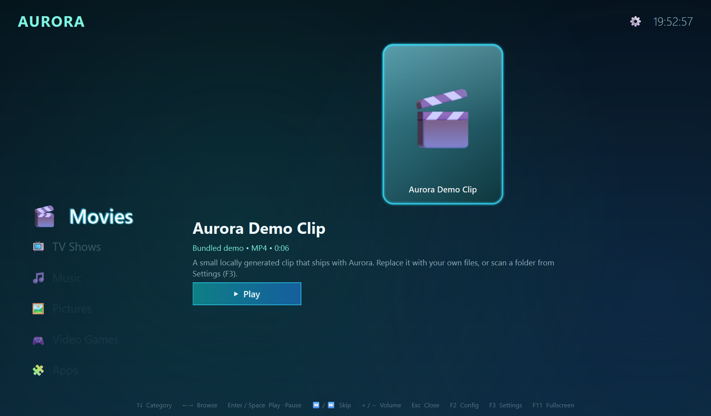

# Aurora

**A fully local, offline media center for your TV.** Aurora is a 10-foot
interface inspired by Windows Media Center and KDE Plasma Bigscreen. It is
built with Python and PySide6 and makes **no network requests at runtime** —
no web server, no browser engine, no telemetry.




## Features

- **Movies, TV, music, pictures, video games, and apps** in one keyboard-
  and mouse-friendly library.
- **Real media playback** through QtMultimedia: video, audio, and a
  fullscreen picture slideshow.
- **Playback queue** — the next track or episode starts automatically;
  skip with the on-screen buttons or media keys.
- **Resume playback** — Aurora remembers where you stopped and offers
  **Resume 1:15** the next time you open that file.
- **Volume overlay** with keyboard, media-key, and mouse-wheel control.
- **Game launcher** — scans game folders, extracts Windows icons, and starts
  games with the right working directory.
- **Privacy filter** — items marked `hidden` never appear unless you turn
  them on in Settings.
- **Hot-reload customization** — edit `theme/theme.qss` or
  `data/library.json` and see the change immediately.
- **Animated 10-foot UI** — glowing background, sliding category menu,
  focused tiles, and a bottom now-playing bar.
- **Works offline** once installed, on Windows, Linux, and macOS.

## Requirements

- Python **3.11+**
- PySide6 **6.6+**
- Windows 10/11, a modern Linux desktop (X11 or Wayland), or macOS

On Linux the PySide6 wheel also needs a few system libraries. Ubuntu/Debian:

```bash
sudo apt install libegl1 libgl1 libxkbcommon0 libxcb-cursor0 \
                 libdbus-1-3 libfontconfig1 libpulse0 libasound2
```

`libxcb-cursor0` is required by Qt 6's xcb platform plugin. For color emoji
icons install `fonts-noto-color-emoji`; `fonts-noto` is a good UI fallback.
Video and audio decode use the FFmpeg backend bundled with PySide6, so no
GStreamer setup is needed.

## Quick start

Download or clone the repository, then from the Aurora folder:

### Windows

Double-click **`run.bat`**, or run it from a terminal:

```bat
run.bat
```

### Linux / macOS

```bash
bash run.sh
```

Both launchers reuse an existing Python + PySide6 installation and only
install what is missing. If Python 3.11+ itself is absent, the launcher asks
**"Install Python now? [Y/N]"**:

- **Yes** — Windows installs via `winget` (falling back to the official
  download page); Linux uses `apt`, `dnf`, `pacman`, `zypper`, or Homebrew.
  Re-run the launcher afterwards so the new `PATH` is picked up.
- **No** — exits with "Python 3.11+ is required to run Aurora."

### Manual install

```bash
python -m venv .venv
# Windows: .venv\Scripts\activate
# Linux/macOS: source .venv/bin/activate
python -m pip install -r requirements.txt
python main.py
```

Options:

| Command | Result |
| --- | --- |
| `python main.py` | Start in fullscreen |
| `python main.py --windowed` | Start in a 1440×860 window |
| `python main.py --smoke-test` | Start, run briefly, and exit (no quit dialog) |

## Controls

| Key | Action |
| --- | --- |
| ↑ / ↓ | Change category |
| ← / → | Move between tiles |
| Enter / Space | Play the focused item, or play/pause while the overlay is open |
| ⏮ / ⏭ (media keys) | Previous / next item in the queue |
| + / − | Volume up / down (mouse wheel also works) |
| Esc | Close the now-playing overlay and stop playback |
| F2 | Open the Aurora folder in Explorer/Files |
| F3 | Settings (also the ⚙ button in the top bar) |
| F11 | Toggle fullscreen / windowed |
| Alt+F4 | Quit — always asks "Are you sure you want to quit?" |

Mouse: click a tile to focus it, then click it again to play. The mouse wheel
scrolls the category menu and tile row, and adjusts volume elsewhere.

## Library and playback

`data/library.json` is created automatically from
[`data/library.example.json`](data/library.example.json) on first run. It
hot-reloads when saved, so you can edit it while Aurora is open.
`data/library.json`, `data/settings.json`, and `data/resume.json` are
gitignored — your own media paths and history never end up in the repository.
The `*.example.json` files are the committed, safe defaults.

A minimal item looks like this:

```json
{
  "title": "My Movie",
  "meta": "2026 • 1080p • 1:42:00",
  "description": "Something about the movie.",
  "hue": 200,
  "icon": "🎬",
  "file": "D:/Media/Movies/My Movie.mp4",
  "duration": 6120
}
```

| Field | Purpose |
| --- | --- |
| `title`, `meta`, `description` | Text shown in the detail panel |
| `hue` | Tile artwork hue, 0–360 |
| `icon` | Tile artwork glyph/emoji |
| `file` | Absolute path, path relative to the Aurora folder, or executable name on `PATH` |
| `file_windows`, `file_linux`, `file_mac` | Optional per-platform overrides; string or list of candidates |
| `duration` | Length in seconds (used when metadata is unavailable) |
| `type` | Optional override: `video`, `audio`, `pictures`, or `app` |
| `hidden` | Keep the item private unless **Show private items** is on |
| `art` | Optional custom tile image path |
| `args` | Extra arguments passed when launching an app or game |

Files that cannot be resolved on the current machine fall back to simulated
playback with a footer notice, so the interface never shows a broken tile.
Scanned items from another machine are hidden automatically; rescan local
folders in **Settings → Media folders**.

### Scanning

Open **F3 → Add folder… → Scan now**. Aurora walks the folders and fills
`data/library.json`:

- videos → **Movies**, or **TV Shows** when the path contains `tv`, `series`,
  or `season`
- audio → **Music**
- images → **Pictures**

Hand-written items are preserved. Previously scanned items are replaced on
each rescan.

### Video games

Add a games folder under **Settings → Games folders** and press
**Scan games**. Aurora finds the main executable of each game folder (skipping
installers, redistributables, and mod helpers), extracts its Windows icon, and
adds it under **Video Games**. Games launch with their folder as the working
directory. Adult-looking titles are flagged private automatically.

### Privacy

Items with `"hidden": true` do not appear anywhere unless
**Settings → Privacy → Show private items** is enabled (off by default).
Hiding is silent — there are no counts or badges. Add `"hidden": true` to any
library item to keep it out of the normal UI.

### Resume points

Resume positions are stored per machine in `data/resume.json`, keyed by the
resolved file path. Points are saved every few seconds, on pause, and on exit;
a point near the end of a file is discarded. Turn the feature off, or clear
all points, from **Settings → Playback**.

## Theme

All colors, fonts, and sizes live in [`theme/theme.qss`](theme/theme.qss),
including the custom-painted background, category menu, and tiles through
`qproperty-*` entries. Save the file and the running app reloads it instantly.

## Demo media

The [`media/`](media) folder contains a tiny real clip, a 6-second tone, and
three slides. They play on any OS, so you can test Aurora before pointing it
at your own library.

## Project layout

```text
main.py                 entry point
run.bat                 Windows launcher
run.sh                  Linux/macOS launcher (venv fallback)
requirements.txt        PySide6
core/
  library.py            load/save, path resolution, privacy helpers
  settings.py           settings defaults and persistence
  playback.py           QtMultimedia, slideshow, queue, resume
  resume.py             resume-point store
  scanner.py            media folder scanner
  games.py              game detection and icon extraction
  hotreload.py          QFileSystemWatcher wrapper
  theme.py              QSS loader
ui/
  main_window.py        layout, navigation, hot reload, quit dialog
  category_menu.py      animated category list
  tile_row.py           animated tile row
  now_playing.py        bottom playback bar
  volume_osd.py         volume overlay
  settings_screen.py    settings dialog and scanners
  background.py         animated gradient/glow
  art.py                generated tile artwork
  quit_dialog.py        quit confirmation
theme/theme.qss         all colors, fonts, and sizes (hot-reload)
data/library.example.json   safe demo library copied on first run
data/settings.example.json  default settings copied on first run
docs/screenshot.png     screenshot used above
media/                  bundled demo clip, tone, and slides
```

## Troubleshooting

- **Qt fails to start on Linux with an xcb error** — install
  `libxcb-cursor0` and the other packages listed above.
- **No audio** — check the system mixer and make sure PulseAudio/PipeWire is
  available to the user running Aurora.
- **Tiles from another computer are missing** — that is intentional; scanned
  items are machine-specific. Rescan local folders in Settings.
- **A game does not launch** — verify the executable path in
  `data/library.json` and check that the game does not require its launcher
  or a different working directory.

## License

Aurora is released under the [MIT License](LICENSE).
